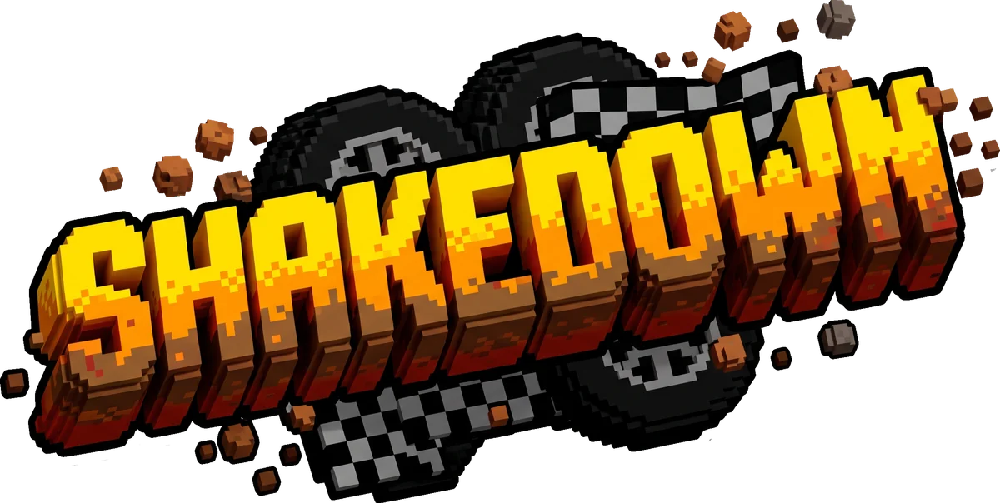

<p align="center"></p>

# Shakedown

Rally diario. Cada medianoche hay una pista nueva, la misma para todos, y una sola pasada oficial. Como el Wordle, pero con autos de rally.

**Jugar:** https://juanmcompa.github.io/shakedown/

**En desarrollo (Early Access).** Desarrollado por Juan M. Comparini.

El resultado se comparte así, con un link que lleva tu pasada y, al final, el aviso de que el juego está en desarrollo:

```
Shakedown #42 🌧️🌲 ⏱️ 01:42:85 🟩 🟩 🟨 🟥 🟩 🏁
https://juanmcompa.github.io/shakedown/#r=k7Qx2Mp
🚧 Early Access · App en desarrollo
```

## La historia

Un club clandestino de puristas del rally, cansados de los circuitos cerrados, busca caminos olvidados. Cada medianoche, el organizador anónimo publica en un foro cerrado las coordenadas y las notas del copiloto del desafío del día: un sendero forestal embarrado, una ruta rural castigada por la lluvia o un paso de montaña de ripio.

No hay vueltas de reconocimiento. Sos vos, tu lectura del terreno y un auto noventero contra el cronómetro: una Vitara del 92 levantada ("La Vitarita") o un Ka con chapón cubrecárter ("El Kacito").

Hay una sola pasada oficial antes de que caigan las autoridades y clausuren el trazado. Al final del día los tiempos se comparan en la tabla del club.

### El equipo

El club tiene su gente. Los dibujó Juanma, y están en `personajes/`:

| | | |
| --- | --- | --- |
| **Gaby**, instructora | **Pablo**, marketing | **Paloma**, médica |
| **Sebastián**, mecánico | **Juanma**, tech | **Gonza**, remolques |
| **Leo**, ingeniero de pista | **Julián**, el rival | **Moi**, motoquero |
| **Rober**, mecánico fan | | |

Aparecen en "El club" y son los que explican el juego la primera vez (ver "La primera vez").

## Cómo es

- **La pista sale de la fecha.** El número del día genera todo: el recorrido, el lugar (bosque, campo o montaña), el clima (seco, lluvia, niebla o atardecer) y las notas del copiloto. La #1 es la del 10 de octubre de 2026. El día cambia a la medianoche de Argentina.
- **Pasadas cortas.** Entre dos y tres minutos, en cinco sectores.
- **Una pasada oficial por día.** Después se puede practicar todo lo que se quiera, pero no cuenta para la tabla.
- **Rally puro.** No hay nafta ni rescates. Si te salís o volcás, volvés al camino con 8 segundos de recargo. Si rompés el auto, es abandono.
- **Los cuadraditos** comparan cada sector contra un tiempo de referencia: 🟩 hasta 1,3 veces la referencia, 🟨 hasta 1,6 veces, 🟥 más que eso. Si hubo que volver al camino en el sector, es 🟥.
- **Pistas pasadas.** Se pueden correr las de los últimos 60 días, como práctica.
- **Circuitos fijos.** Además de la pista del día hay cuatro recorridos que no cambian nunca, para correr las veces que se quiera. Queda guardado el mejor tiempo de cada uno y se comparte igual que el del día. Uno es una vuelta cerrada para practicar: no tiene llegada, se dan las vueltas que se quiera.
- **Clubes de amigos.** Con un link de invitación se arma un grupo con tabla propia: la pasada oficial de cada uno aparece sola, con su nombre y su tiempo (ver "Correr contra amigos").
- **Trazada para seguir.** Optativa: una línea pintada en el camino muestra por dónde pasar, como en los juegos de carreras. Está verde donde se puede acelerar, amarilla donde venís justo y roja donde venís pasado: cuando el rojo llega al auto, hay que frenar. Se prende en la configuración o con la `T`. Es solo un dibujo: no cambia el manejo ni marca el tiempo.
- **Ayuda de manejo, para arrancar.** Se prende en la configuración: el auto sigue solo la trazada, frena antes de las curvas y se cruza menos; vos acelerás y corregís con el volante. Es más fácil y más lento. En la tabla, esos tiempos llevan un salvavidas. Después de una pasada complicada, el juego la ofrece.
- **Antorchas rojas.** Las piedras que quedaron pegadas al camino llevan una antorcha roja, para verlas venir.
- **Sponsors de mentira.** Las pistas llevan publicidad, como un rally de verdad: FPY, CAC y Mercado Ladri. Son solo de adorno y se cambian tocando una lista (ver "Los sponsors").

## Los circuitos

Se abren con el botón de circuitos de la portada.

| Circuito | Cómo es |
| --- | --- |
| ⛰️ **Subida a Mina Vieja** | 1,2 km de montaña, siempre para arriba. Angosta, con siete horquillas, tres puentes de madera y tramos de lajas que hay que pasar despacio. No hay velocidad: es técnica. Donde el camino se asoma al vacío hay una pirca que frena al auto en vez de dejarlo caer. |
| 🦅 **Bajada del Portezuelo** | 2,5 km de ripio suelto, ancha y siempre para abajo: 325 metros de desnivel. Es la más rápida del juego: rectas largas donde se pasan los 100 km/h, eses para llevar el auto cruzado, un salto y cuatro curvas cerradas a las que hay que llegar frenado (en bajada cuesta más). |
| 🏘️ **Callejero de Villa Cañada** | 1,1 km entre las casas de un pueblo: esquinas de 90 grados, calles de adoquines, la vuelta a la plaza, un pasaje angosto y una avenida con autos estacionados, un colectivo, volquetes, conos y un lomo de burro. |
| 🔁 **Vuelta del Club** | 1,6 km en vuelta cerrada, para practicar. Sale por la ruta, cruza un pueblo (una esquina de 90, adoquines, un lomo de burro y conos), se mete en el bosque (un vado y un barrial), trepa al cerro (dos horquillas, una cornisa de lajas con pirca y un puente) y baja rápido, con un salto, de vuelta al campo. |

Cada circuito tiene su tiempo de referencia y sus cinco cuadraditos, como la pista del día. El mensaje para compartir sale así:

```
Shakedown · Urbano 🏘️ ⏱️ 01:30:42 🟩 🟩 🟩 🟩 🟩 🏁
```

**La Vuelta del Club no tiene llegada.** Se larga unos metros antes de la raya y el reloj arranca al cruzarla. Cada vez que se la vuelve a cruzar se cierra una vuelta: aparece su tiempo, el reloj y los cuadraditos empiezan de nuevo y el auto queda arreglado. La mejor vuelta queda guardada y pasa a ser el fantasma contra el que se corre. Para terminar se sale con `Esc` (o con la X en el celular) y se ve el resultado de la mejor vuelta, que es la que se comparte.

## Pistas de la comunidad

Las arma la gente en el **creador**, nota por nota, como las cantaría el copiloto. No hay mapa: se eligen las notas y el camino sale solo. Leo, el ingeniero de pista, va diciendo qué pasa.

- **Dónde.** Se abre desde **Circuitos** (`Armar una pista`) o desde la tabla de un club (`Armar una para el club`). Lo que se va armando queda guardado en el aparato: se puede cerrar y seguir otro día.
- **Las notas.** Curvas para cada lado (del 6, casi recta, al 1, la más cerrada; la horquilla y la esquina de 90), rectas de 50, 100 y 180 metros, cosas del camino (salto, vado, puente, barro, angosto, lomo de burro y una cuadra de pueblo; en la montaña, además, cornisa y lajas) y cosas al costado (público, piedras, conos y fardos, que van en la nota de antes). La largada y la llegada se ponen solas.
- **El camino no se cruza.** No puede pasar por donde ya pasó ni irse demasiado lejos: las notas que no entran como siguiente se ven apagadas, y si se las toca Leo dice por qué. El ambiente y el clima se cambian cuando se quiera: cambian el suelo y el paisaje, no el recorrido.
- **Medidas.** De 700 metros a 3,2 km, con hasta 40 notas de camino y 30 cosas al costado.
- **Probar** la corre como borrador: los tiempos quedan en el aparato y no se comparten. **Publicar** la sube al servidor con su nombre: dura dos semanas, tiene su tabla con el mejor tiempo de cada uno que la corre, y se comparte con un link (`…/shakedown/?pista=13042-1`). Si se la arma para un club, aparece en la tabla del club para todos sus miembros: así cada club hace sus propias pistas.
- **Cinco por persona.** Cada uno puede tener hasta cinco publicadas a la vez. Para publicar otra, se borra una con el tacho (dos toques), en Circuitos o abajo de todo en el creador. Se va con todos sus tiempos.
- **Se corren como un circuito.** No hay oficial: se corren las veces que se quiera y queda el mejor tiempo. Las que armaste, las que abriste y las de tus clubes aparecen en Circuitos mientras duren.
- **Quién la armó la firma.** Su nombre sale en la portada de la pista y en todo lo que se comparte de ella (no al largar). Compartir la pista desde su portada, antes de correrla:

```
Shakedown · Pista «La Curva del Tero» por Juanma 📝 ¿Quién la hace más rápido?
```

Y un resultado en esa pista (lo comparta quien lo comparta, la firma es de quien la armó):

```
Shakedown · Pista «La Curva del Tero» por Juanma 📝 ⏱️ 01:12:34 🟩 🟩 🟨 🟥 🟩 🏁
```

El link lleva el número de la pista y su versión: cuando una vence (o la borran), su número se puede volver a usar, y un link viejo nunca abre la pista nueva. Las pistas de la comunidad son lo único del juego que necesita el servidor.

## Los sponsors

Las pistas llevan publicidad en cinco lugares: banderas a los costados de la largada y de la llegada, chapas apoyadas en la cinta del público, cartelones al costado del camino, pórticos en las calles del pueblo y una tira de marcas arriba de cada arco.

Las marcas son un chiste: **FPY**, **CAC** y **Mercado Ladri**. El parecido con marcas de verdad es a propósito, y los nombres están cambiados también a propósito.

- **Es solo dibujo.** Nada de esto se choca ni cambia la pista. Se puede sumar, sacar o cambiar un sponsor sin tocar los tiempos de nadie y sin subir la `VERSION`. Si el auto se lleva puesta una chapa o un cartelón, queda tirado en el piso; al auto no le pasa nada.
- **Se reparten solos.** Cada pista sortea dónde van, igual para todos. Los cartelones aparecen solo donde hay lugar: lejos de los árboles, del público y del agua. Por eso en el bosque hay menos que en el campo.
- **La lista** está en `src/parodias.js`. (No se llama "sponsors" a propósito: ver "Los nombres de los archivos", más abajo.) Cada sponsor lleva un nombre, dos colores y hasta tres dibujos de pocos píxeles: el cartel grande, la chapa y la bandera. Los dibujos se escriben renglón por renglón, con un punto para el fondo y un numeral para la tinta.
- **`peso`** dice cuánto aparece cada uno: con peso 2 sale el doble que los demás.
- **Con una imagen.** En vez de escribir los renglones se puede dibujar un PNG chiquito, guardarlo en una carpeta del juego (por ejemplo `parodias/`) y nombrarlo en `imagen`. Medidas: cartel 52 × 16 píxeles, chapa 21 × 7 y bandera 7 × 25. Lo transparente deja ver el color de fondo. Si la imagen es más grande, se achica.
- **Sin dibujo.** Al soporte que le falte el dibujo se le escribe el nombre con las letras del juego. Para probar un sponsor nuevo alcanza con el nombre y los dos colores. En la chapa entran cinco letras y en la bandera tres: si el nombre es más largo, conviene darle un `corto`.

Un píxel de estos dibujos mide 12,5 cm, igual que los de los autos.

## Correr contra amigos: links y clubes

- Al terminar, poné tu nombre y compartí. En la compu se copia el mensaje con el link; en el celular se abre el menú de compartir.
- El mensaje tiene tres renglones: el resultado, el link y el aviso (`🚧 Early Access · App en desarrollo`). La invitación a un club cierra con el mismo renglón. Al pegar el link, la vista previa también lo dice: en el título, en la descripción y en la imagen. Quién hace el juego no va en lo que se comparte: se ve solo en la portada.
- Quien abre tu link te ve en su tabla y **corre su pasada oficial contra tu fantasma**, que hace exactamente lo que hiciste vos.
- Sin link de nadie, la oficial se corre solo. En las prácticas, el fantasma es tu mejor pasada.
- En la tabla, el botón del fantasma elige contra quién corrés.

**Clubes.** En la tabla, el `+` arma un club: le ponés un nombre y lo invitás con un link, una sola vez, en el grupo. El que abre la invitación queda adentro. Desde ahí, la pasada oficial de cada uno aparece sola en la tabla del club, con su nombre, su tiempo y su fantasma, y abajo dice quiénes todavía no corrieron. Se puede estar en todos los clubes que se quiera: la oficial del día es una sola y vale para todos, también para un club al que te sumes después de correr. Si entrás a un club sin haber puesto tu nombre, la tabla te lo pide: así los demás te reconocen.

**El servidor.** Los clubes, los links cortos (`…/shakedown/#r=k7Qx2Mp`) y las pistas de la comunidad necesitan un servidor chico que guarde las pasadas: está en la carpeta `servidor/` y corre gratis en Cloudflare ([cómo publicarlo](servidor/LEEME.md)). El juego no depende de él:

- Sin servidor configurado (`SERVIDOR` vacío en `src/config.js`), o si un día no contesta, el link lleva la pasada completa adentro (por eso es largo: de 500 a 800 letras) y la tabla se arma con los links que se abren. Ese link también lleva los tiempos que te llegaron por otros links, así la tabla se va completando entre todos. (Lo que sabés por un club no viaja en tus links: queda en el club.)
- Los links largos que ya se compartieron siguen andando siempre.
- No hay cuentas ni contraseñas: se guarda el nombre que cada uno elige, su tiempo y su pasada. Nada más: ni mails, ni direcciones de internet, ni publicidad, ni programas de terceros que sigan a la gente.
- El servidor solo deja escribir al juego publicado, y revisa lo que puede (ver [`servidor/LEEME.md`](servidor/LEEME.md)). No es a prueba de tramposos: alcanza para clubes de amigos.

## La primera vez

La primera vez que alguien larga en un aparato, el juego lo frena un minuto en la largada y el equipo le explica lo que tiene en pantalla, de a una cosa, iluminándola:

1. **Gaby** (instructora): con qué se maneja. En la compu, las teclas; en el celular, los pedales y cómo se dobla (inclinando, o con las flechas si el celular no tiene sensor).
2. **Leo** (ingeniero de pista): las notas de arriba, y que hay que frenar antes de la curva.
3. **Julián** (el rival): el reloj, los sectores y que la oficial es una sola.
4. **Sebastián** (mecánico): la barra de daño.
5. **Gonza** (remolques): el botón de volver al camino.
6. **Paloma** (médica): ofrece largar con la ayuda de manejo.

Se puede saltar, cerrar con la X (vuelve a la portada, sin gastar la oficial) y volver a ver desde "Cómo se juega". Que alguien es nuevo se sabe porque en ese aparato no hay nada guardado: ni una pasada, ni el tutorial visto. No se le pregunta nada a ningún servidor.

## Cómo se juega

| Tecla | Qué hace |
| --- | --- |
| `W` `A` `S` `D` o flechas | Acelerar, doblar, frenar y marcha atrás |
| `Espacio` | Freno de mano |
| `R` | Volver al camino (suma 8 segundos) |
| `C` | Cámara: aérea, de atrás o desde arriba |
| `M` / `V` | Sonido / voz del copiloto |
| `T` | Trazada: prende o apaga la línea para seguir |
| `Enter` | Largar |
| `Esc` | Dejar una práctica |

En el celular los botones son íconos y muestran su estado:

- **Inclinar el celu** para doblar. En iPhone pide permiso para usar el sensor. Si el sensor no responde, aparecen flechas.
- **Pedales:** el derecho acelera, el izquierdo frena y da marcha atrás (aparece una R). Pisados se llenan de color.
- **Freno de mano:** arriba del freno. Se pone amarillo mientras está apretado.
- **Cámara:** el ícono es el auto visto como lo ves, y tres puntitos marcan cuál de las tres está puesta.
- **Sonido y voz del copiloto:** apagados se ven tenues y tachados.
- **Volver al camino:** lleva el "+8" de lo que cuesta. Titila en amarillo cuando el auto quedó trabado.
- **La portada entra entera en la pantalla.** Abajo quedan fijos el botón de largar y las secciones (tabla, circuitos, pistas pasadas, ayuda y configuración). Si la pista tiene mucho para mostrar, se corre con el dedo solo la parte de arriba, y una flechita avisa que hay más.
- **Las cámaras se acomodan a la pantalla.** En el celular, la aérea va más cerca, la de atrás más lejos, y el auto queda siempre por arriba de los pedales, para que no lo tapen los pulgares.
- **Mientras carga** se ve la marca con una barra y lo que está haciendo. Si no puede cargar, lo dice, ofrece probar de nuevo y muestra un código con lo que falló (ver "Si no carga").
- **Al largar**, mientras dura la cuenta regresiva, un cartel avisa que el juego está en desarrollo (Early Access). Se va solo cuando arranca la pasada.
- **La firma** ("Desarrollado por Juan M. Comparini") va solo en la portada, debajo de la marca: no en la largada ni en lo que se comparte.

Las notas del copiloto aparecen arriba y se escuchan. Los números van del 1 (curva muy cerrada) al 6 (casi recta). H es una horquilla y 90, una esquina. También avisa los puentes, las lajas, los adoquines y los lomos de burro.

## Si no carga

Cuando el juego no puede arrancar, la pantalla de carga dice qué hacer y, abajo, deja un renglón así:

```
Código R0 · carteleria.js (sin respuesta) · pág. 17 · Chrome 141, Android 14
```

Con una captura de esa pantalla alcanza para saber qué pasó. La letra dice qué falló y el número, en qué paso de la carga estaba (0 = el programa todavía no había arrancado; del 1 al 6: buscar la pasada del link, armar la pista, el paisaje, el auto, los últimos ajustes y el primer cuadro).

| Código | Qué pasó | Qué suele ser |
| --- | --- | --- |
| **R** | No bajó un archivo del juego. Dice cuál, y qué contestó el sitio | `(sin respuesta)` en uno o dos archivos, y los demás bien: algo en ese aparato lo frena (un bloqueador de publicidad, un antivirus, el filtro de una red). `(404)`: al sitio le falta ese archivo; pasa unos minutos después de publicar. "No responde ninguno": no hay conexión |
| **E** | Falló el programa. Dice en qué archivo y en qué renglón | Un error del juego en ese aparato: hay que arreglarlo |
| **P** | Falló algo que el programa estaba esperando | Lo mismo que E. A veces no impide jugar: si el juego termina de cargar, el cartel se va solo |
| **V** | El navegador no entiende el programa | Un navegador viejo: hay que actualizarlo |
| **G** | No se pudieron prender los gráficos 3D | El aparato o el navegador no tienen WebGL 2, o está apagado |
| **T** | Pasaron 40 segundos y sigue cargando | Un aparato lento o una conexión mala. No corta nada: se puede esperar |

Al lado de "Probar de nuevo" hay un botón que copia el detalle completo (en el celular abre el menú de compartir): el error entero, qué archivos no bajaron, el navegador y el aparato. No se manda solo a ningún lado: lo manda quien quiera, pegándolo en un chat.

## Configuración

La tuerca de la portada abre la configuración. Lo que se elige queda guardado en el aparato.

- **Ayuda de manejo:** sí o no.
- **Trazada:** sí o no. Es la línea pintada en el camino que muestra por dónde pasar y dónde frenar. Mientras no se la toque, acompaña a la ayuda de manejo: con ayuda viene prendida, para que se vea por dónde va a ir el auto.
- **Distancia de la cámara:** más cerca o más lejos. Mientras se mueve la barra, el panel se corre para ver cómo queda.
- **Doblar** (celular): inclinando o con flechas en pantalla.
- **Sensibilidad al inclinar** (celular): cuánto hay que inclinar para llevar el volante a fondo. Se prueba ahí mismo: un punto amarillo muestra el volante.
- **Pedales** (celular): chicos, normales o grandes.
- **Desenfoque y brillos:** sin ellos el juego anda más liviano.
- **Sonido** y **voz del copiloto.**

## Qué tocar para cambiar el juego

| Para cambiar | Archivo |
| --- | --- |
| Cómo se maneja cada auto, los suelos, las cámaras, el recargo y los cuadraditos | `src/config.js` |
| Cuánto ayuda la ayuda de manejo (`AYUDA`) y con qué configuración arranca el juego (`GUSTOS`) | `src/config.js` |
| El aviso de que el juego está en desarrollo (el cartel de la largada y el último renglón de lo que se comparte) y la firma de la portada (`FIRMA`) | `src/config.js` |
| Lo mismo, en la vista previa del link (título, descripción e imagen) | El principio de `index.html` y `vista-previa.jpg` |
| Los textos y los códigos de la pantalla de "no se pudo cargar" | El principio de `index.html` |
| Lo que dice cada personaje en el tutorial de la primera vez, en qué orden y qué ilumina (`PASOS`) | `src/tutorial.js` |
| Las notas del creador de pistas y cómo se arma el camino de cada una (`PIEZAS`); el largo mínimo y el máximo (`TOPES`) | `src/hoja.js` |
| Lo que dice Leo en el creador y cómo se ordenan los botones de las notas | `src/creador.js` |
| Cuánto duran las pistas de la comunidad y cuántas puede tener cada uno (`COMUNIDAD`) | `src/circuitos.js` |
| Los personajes: nombres, roles y cuáles hay (`EQUIPO`); sus retratos | `src/equipo.js`, `personajes/` |
| La trazada: sus colores, el tamaño de las rayitas y desde qué velocidad avisa (`RITMO`, `FRENADA`, `JUSTO`) | `src/trazada.js` |
| Cómo se arman las pistas: biomas, climas, tipos de tramo, nombres de lugares | `src/generador.js` (y subir `VERSION` ahí mismo: ver abajo) |
| El recorrido de cada circuito fijo: sus rectas, curvas, puentes, casas y cosas en la calle, y por qué ambiente pasa cada pedazo | `src/circuitos.js` (cada circuito es una lista que se lee de arriba hacia abajo; al cambiar uno hay que subirle su `version`) |
| Las medidas de los edificios y de las cosas de la calle, y cuáles se caen al chocarlas | `src/edificios.js` |
| Los dibujos de las casas, los colectivos, los faroles, las barandas y las pircas | `src/pueblo.js` |
| Los sponsors: nombres, colores, dibujos y cuánto aparece cada uno | `src/parodias.js` |
| La dirección del servidor de los clubes (`SERVIDOR`) | `src/config.js` |
| Los topes del servidor: pasadas por día, tamaño de los clubes, pistas de la comunidad, cuánto se guarda (`LIMITES`) | `servidor/worker.js` |
| Dónde va la publicidad, cuánta hay y qué tan vivos son sus colores (`VIVO`) | `src/carteleria.js` |
| Qué día es la pista #1 | `src/dia.js` |
| Los colores de todo (cuánto se apagan, el tono polvoriento) | `PALETA`, al principio de `src/pixel.js` |
| La luz y la bruma de cada clima | `LUCES` en `src/world.js` y `REVELADOS` en `src/post.js` |
| Los dibujos de los pisos, árboles y carteles | `src/arte.js` |
| Los dibujos planos: público, plantas, vacas, fogones | `src/sprites.js` |
| Los autos: forma, pintura y números | `src/autos.js` |
| Los íconos de los botones y de las notas | `src/iconos.js` |
| Los textos de la portada y la ayuda | `src/menu.js` |

El juego no usa archivos de imagen: todo se pinta con código, de a píxeles, cuando arranca. Un píxel del mundo mide 25 cm. La única excepción posible son los sponsors, que pueden traer su PNG.

## Cómo está armado

Es HTML, CSS y JavaScript sin instalación ni compilado. Subir al repo es publicar: GitHub Pages lo actualiza en un minuto.

Mientras está en desarrollo, la página vuelve a pedir los archivos del juego en cada visita, así los cambios se ven apenas se publican. Si se suma un archivo nuevo en `src/`, hay que agregarlo a la lista que está al principio de `index.html`.

### Los nombres de los archivos

Ningún archivo ni carpeta del juego puede llevar en el nombre una palabra de anuncios: `publicidad`, `sponsor`, `banner`, `ads`, `anuncio` y parecidas. Los bloqueadores de publicidad (uBlock Origin, AdGuard, Adblock Plus) frenan las direcciones que las contienen, y como el juego necesita todos sus archivos, con uno solo frenado no carga: aparece el cartel de "No se pudo cargar el juego".

Ya pasó: el archivo que dibuja los carteles de la pista se llamaba `publicidad.js` y lo frenaba la regla `/publicidad.` de la lista en español de AdGuard, que uBlock Origin también prende sola cuando el navegador está en castellano. Por eso hoy se llama `carteleria.js`, y la lista de sponsors, `parodias.js`. La regla vale también para las imágenes y para los nombres de las cosas de la página (`id` y `class` en `index.html`): esos mismos bloqueadores esconden lo que se llame, por ejemplo, `banner` o `publicidad`.

| Archivo | Qué hace |
| --- | --- |
| `index.html`, `style.css` | La página: portada, tablero, botones y paneles |
| `personajes/` | Los retratos del equipo (431 x 458, con el fondo de afuera transparente y el marco siempre en el mismo lugar) |
| `vista-previa.jpg` | La imagen que muestra WhatsApp cuando se pega el link |
| `marca/`, `manifest.webmanifest` | El logo, los íconos (pestaña, celular) y los datos para agregar el juego a la pantalla de inicio |
| `servidor/`, `wrangler.jsonc` | El servidor de los links cortos y los clubes, y cómo se publica en Cloudflare |
| `src/main.js` | Arma todo y corre el ciclo del juego |
| `src/config.js` | Los números para ajustar |
| `src/dia.js`, `src/generador.js` | El calendario y el generador: de un número de día sale una pista |
| `src/circuitos.js` | Los circuitos fijos, escritos a mano |
| `src/hoja.js`, `src/creador.js` | Las pistas de la comunidad: de la hoja de notas que arma un jugador sale el camino; el creador, donde se arma la hoja |
| `src/terrain.js` | Convierte la pista en terreno: alturas, suelos, agua, puentes, árboles, público, y dónde va cada casa, cada pirca y cada cosa de la calle |
| `src/edificios.js`, `src/pueblo.js` | Las medidas de los edificios y de las cosas de la calle, y cómo se dibujan |
| `src/referencia.js` | Calcula la trazada, el tiempo de referencia de cada sector y dónde hay que frenar |
| `src/vehicle.js` | La física del auto |
| `src/reglas.js` | Cuenta regresiva, sectores, recargos, daño y abandono; y las vueltas, en el circuito cerrado |
| `src/ayuda.js` | La ayuda de manejo: lleva el auto por la trazada y regula los pedales antes de las curvas |
| `src/trazada.js` | La trazada pintada en el camino, y sus colores |
| `src/copiloto.js` | Las notas y la voz que las canta |
| `src/fantasma.js`, `src/club.js` | Graban la pasada y la meten en un link; lo que se guarda en el aparato (tu pasada, la tabla, tus clubes, tus gustos, el borrador del creador y las pistas de la comunidad que conocés) |
| `src/nube.js` | Lo que el juego le pide al servidor: guardar y traer pasadas, los clubes y las pistas de la comunidad |
| `src/menu.js`, `src/hud.js`, `src/iconos.js` | Portada, paneles y resultado; el tablero mientras se corre; los íconos |
| `src/equipo.js`, `src/tutorial.js` | Los personajes del club, y el tutorial de la primera vez |
| `src/world.js`, `src/flora.js`, `src/utileria.js`, `src/publico.js`, `src/clima.js` | Dibujan el terreno, la vegetación, los arcos y carteles, las antorchas de las piedras, el público, la lluvia y los faros |
| `src/parodias.js`, `src/carteleria.js` | La lista de sponsors, y dónde va y cómo se dibuja su publicidad |
| `src/autos.js` | Los modelos de los autos y el fantasma |
| `src/material.js`, `src/pixel.js`, `src/arte.js`, `src/sprites.js` | El estilo: materiales, herramientas para pintar de a píxeles, y los dibujos |
| `src/post.js` | El "revelado": desenfoque de maqueta, brillos y ajuste de color. Se apaga solo si el aparato no da |
| `src/huellas.js`, `src/fx.js` | Las huellas en el piso y la pintura de las calles; el polvo que queda flotando y el barro y el agua que saltan de las ruedas |
| `src/camera.js`, `src/audio.js`, `src/input.js`, `src/noise.js` | Cámaras, sonido del motor, mandos y ruido para el relieve |
| `vendor/` | Three.js (la biblioteca 3D) y las tipografías |
| `tools/` | Pruebas sin gráficos (opcionales) |

Los archivos de `src/` se piden entre sí por su camino (`./config.js`, `../vendor/three.module.js`), sin nombres sueltos. Así el juego carga también en los navegadores que no entienden el mapa de importación de `index.html` (los iPhone con iOS 15 y 16). Ese mapa solo sirve para que los cambios se vean apenas se publican.

## Probarlo en tu compu

Abrir `index.html` con doble clic no funciona: el navegador no carga los módulos desde un archivo suelto. Dos formas:

- En VS Code, con la extensión Live Server: clic derecho sobre `index.html` y "Open with Live Server".
- O subir los cambios y probar en la página publicada.

Direcciones útiles para probar:

- `?p=3` abre la pista #3, si ya pasó. Con `?p=6&futuro` se abre cualquiera, aunque todavía no haya llegado su día (como práctica).
- `?c=subida`, `?c=bajada`, `?c=urbano` y `?c=practica` abren los circuitos.
- `?pista=borrador` abre el borrador del creador, y `?pista=13042-1` una pista de la comunidad (esa necesita el servidor).
- `?simple` saca el desenfoque y los brillos.

## Pruebas (opcional)

Con Node instalado, desde la carpeta del repo:

- `node tools/piloto.mjs 1 12`: cinco pilotos de distinto nivel corren las pistas 1 a 12 con cada auto. Dice si llegan, en cuánto, y dónde se salen.
- `node tools/piloto.mjs 16001 4`: lo mismo en los cuatro circuitos (sus números de pista van del 16001 al 16004). En la vuelta cerrada cada piloto da tres vueltas y cuenta la mejor.
- `SOLO=novato,ayudado,sinManos node tools/piloto.mjs 1 8`: un piloto que no suelta nunca el acelerador, sin y con la ayuda de manejo; y `sinManos`, que además no toca el volante. Sirve para ver cuánto ayuda. Para probar otros números sin tocar `config.js`: `AYUDA="ritmo=0.74,frena=3.2" SOLO=ayudado node tools/piloto.mjs 1 8`.
- `node tools/fisica.mjs`: aceleración, frenada, curvas y subidas en cada suelo.
- `node servidor/prueba.mjs`: prueba el servidor de los clubes y de las pistas de la comunidad sin publicar nada (pide Node 22 o más nuevo).
- `node tools/maniobras.mjs`: qué tan fácil se descontrola cada auto con volantazos.

Sirven para revisar que las pistas se puedan terminar después de tocar `config.js`, `generador.js` o `circuitos.js`.

**Si un cambio hace que la pista de un día sea otra** (tocar el generador o cómo se arma el terreno), hay que subir el número `VERSION` de `src/generador.js`. Con eso, lo que cada uno tenía guardado de la versión anterior se descarta solo (esos tiempos y fantasmas eran de otro camino) y la oficial del día se puede correr de nuevo. Los circuitos llevan cada uno su `version`, en `src/circuitos.js`: al cambiar el recorrido de uno se sube la suya, y lo guardado de los demás no se toca.

## Plan

El plan de desarrollo está en [PLAN.md](PLAN.md).

## Créditos

Desarrollado por Juan M. Comparini. El juego está en desarrollo (Early Access).

Hecho con [Three.js](https://threejs.org/) (licencia MIT). Tipografías [Barlow y Barlow Condensed](https://github.com/jpt/barlow) (licencia OFL), incluidas en `vendor/fuentes`.
